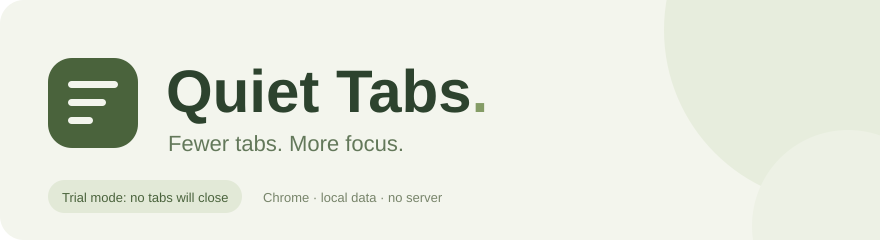

<p align="center">
  
</p>

<p align="center">
  <strong>Understand which tabs you can let go.</strong><br>
  A Chrome extension that identifies stale tabs using meaningful viewing time,<br>
  with a Recommendations mode that closes tabs only with your approval.
</p>

<p align="center">
  
  
  
  
</p>

<p align="center">
  <a href="#quick-start">Quick start</a> ·
  <a href="#attention-model">Attention model</a> ·
  <a href="#operating-modes">Modes</a> ·
  <a href="#privacy-and-permissions">Privacy</a> ·
  <a href="docs/DEVELOPMENT.md">Development</a>
</p>

## Overview

Quiet Tabs helps manage the pages left open for later. It tracks how long you actually keep a tab selected, gives frequently used pages more time, and explains why an unused tab is ready for review.

Opening a tab briefly while searching for something does not make it important. Twenty half-second visits count as ten seconds of visibility and **zero qualified attention**.

> [!NOTE]
> **New installations start in Recommendations mode.** Choose **Agree & close** to save a suggested tab's link and close it. This mode never switches to automatic closing on its own.

## Features

| Feature | Behavior |
| --- | --- |
| **Recommendations with manual closing** | Review suggestions and close a tab when you agree, saving its link first |
| **Meaningful attention tracking** | Separate brief scans from continuous visits |
| **Adaptive retention periods** | Keep tabs with more accumulated attention for longer |
| **Suggestion journal** | Review the latest 500 suggestions and choose Agree & close, Needed or Tomorrow |
| **Tab and domain protection** | Keep selected, pinned, audible and explicitly protected tabs out of suggestions |
| **Link archive** | Save a link before closing; restore it later in the background |
| **Local storage** | No account, server, telemetry or external network requests from the extension |
| **English and Russian** | Switch languages with EN / RU in the panel; your choice is saved locally |

## Quick start

Requires **Google Chrome 120 or later**. Node.js is not required to use the extension.

1. Download the repository using **Code → Download ZIP**, or clone it.
2. Extract it to a permanent folder. Locate the directory containing `manifest.json`.
3. Open `chrome://extensions` and enable **Developer mode**.
4. Select **Load unpacked** and choose that directory.
5. Pin **Quiet Tabs** from Chrome's Extensions menu, then open its side panel.
6. Confirm that the panel says **Recommendations · you choose what to close**.

Keep the extension folder in place: Chrome loads the unpacked extension directly from it.

Use **EN / RU** in the panel header to switch the interface language. This updates labels, settings, messages and dates without changing the operating mode or retention rules. Page titles remain in their original language. Project documentation is in English.

Use **Qualified ↑ / ↓** above any list to sort by qualified attention, from least to most or most to least. The choice is saved and shared across Suggestions, All, Journal and Archive. Journal and archive entries use the time recorded when they were saved; older archive entries without this measurement appear last.

When you open or close a page from **Suggestions**, **All** or **Journal**, the displayed cards stay in place. A closed page keeps an inactive card so a repeated click cannot act on its neighbor. The close button stays disabled while a tab is selected or otherwise protected. Switch to another browser tab before closing a still-current suggestion. Click the list name again, search or sort to refresh the list's membership and order.

With default settings, the first suggestions appear after **24 hours of observation**, provided a tab is not protected. To try recommendations sooner, set the first retention period to one hour while keeping Recommendations mode selected.

See the [installation guide](INSTALL.md) for updates, another computer and troubleshooting.

## Attention model

A visit qualifies after **15 continuous seconds** in the selected tab of the focused Chrome window, while the computer is not idle. The threshold is configurable from 5 to 120 seconds.

Short visits contribute to visible time, but do not reset the inactivity clock. Once a visit qualifies, its entire duration counts, including the initial seconds.

| Browsing pattern | Visible time | Qualified attention |
| --- | --- | --- |
| 20 visits of 0.5 seconds | 10 seconds | 0 seconds |
| One continuous 20-second visit | 20 seconds | 20 seconds |
| 10 separate visits of 10 seconds | 100 seconds | 0 seconds |

Retention depends on the total qualified attention accumulated for the current page:

| Total qualified attention | Default time before a suggestion |
| --- | --- |
| Less than 1 minute | 24 hours |
| 1 minute to under 10 minutes | 2 days |
| 10 minutes or more | 5 days |

The clock starts at the last qualified visit, or at first observation if there has not been one. All three retention periods are configurable. Updates preserve your saved settings; to use these defaults in an existing installation, set the periods to 24, 48 and 120 hours.

Attention is an estimate based on browser focus and computer activity. It does not measure reading, comprehension or interaction with page contents. See [behavior and limitations](docs/BEHAVIOR.md) for timing, navigation and restart details.

## Operating modes

| Mode | Suggestions | Closing |
| --- | --- | --- |
| **Recommendations** — default | Suggestions, journal and feedback | Only on your request, with **Agree & close** |
| **Automatic** | Review the same candidates | Starts after a one-hour delay; up to 5 tabs per 15 minutes |

Automatic mode requires an explicit selection and acknowledgment that the archive saves links only.

Recommendations combines the former Trial and Suggest modes. Existing settings migrate automatically, preserving your journal, archive, protection and retention periods. An already selected Automatic mode stays selected.

In Recommendations mode:

- **Agree & close** saves the link, closes the matching suggested tab and records your assessment. Old or protected suggestions cannot close a tab.
- **Needed** records feedback and protects the matching tab if it is still open.
- **Tomorrow** records feedback and postpones the matching tab for one day.

Feedback helps you evaluate and tune the settings. Version 0.2.0 does **not** train a model or automatically adjust rules from your feedback.

## Protection and recovery

Selected tabs in every window, pinned tabs, audible tabs, loading pages, split-view tabs and tabs protected from discarding by Chrome are excluded from suggestions. You can also keep individual tabs, snooze them or exclude entire domains and their subdomains.

Chrome internal pages, local files and incognito tabs are not tracked.

> [!IMPORTANT]
> The archive saves **URLs and titles**, not unsaved forms, drafts, navigation history or scroll position. Exclude editors and meeting sites before choosing a mode that closes tabs.

Links are persisted before closing. If saving fails or the 500-link archive is full, closing stops. Restoring a link opens it in the background and protects the new tab for one day.

## Privacy and permissions

The extension stores tab URLs, titles, attention statistics, settings, feedback and archived links in the local Chrome profile. It does not read page content, inject content scripts, use analytics, fetch favicons or load external fonts. No host permissions are requested.

| Permission | Purpose |
| --- | --- |
| `tabs` | Read tab metadata and perform explicitly enabled tab actions |
| `storage` | Persist settings, statistics, the journal and archived links locally |
| `idle` | Pause attention tracking when the computer is idle |
| `alarms` | Periodically update statistics and evaluate candidates |
| `sidePanel` | Display the review interface beside your tabs |

Data is not synchronized across devices. Copying the source folder or installation ZIP does not copy browsing data. Removing the extension deletes its local data.

## Development

The runtime uses dependency-free JavaScript, HTML and CSS. JSDoc and TypeScript provide strict type checking without a build step. Node.js 24 is the development baseline.

```sh
npm ci --ignore-scripts
npm run check
npm run package
```

`npm run check` runs type checking, automated tests and extension validation. `npm run package` creates an unpacked extension folder and a ZIP in `dist/`; development dependencies and tests are excluded.

For a local interface demo using fictional tabs:

```sh
npm run preview
```

Open `http://127.0.0.1:43127/panel.html`. This demo does not access real tabs.

See the [development guide](docs/DEVELOPMENT.md) for architecture, testing and packaging.

## Project status

**Early release · v0.2.0.** Automated tests cover attention accounting, manual closing safeguards, mode migration, persistence, background events and interface behavior with simulated Chrome APIs. They do not replace testing in a real browser profile.

Cloud synchronization, data export and automatic learning from feedback are not implemented. For the complete behavior contract, read [behavior and limitations](docs/BEHAVIOR.md).

Bug reports should include the extension version, Chrome version, operating mode, reproduction steps and expected behavior. Use fictional URLs when reporting issues involving browsing data.
